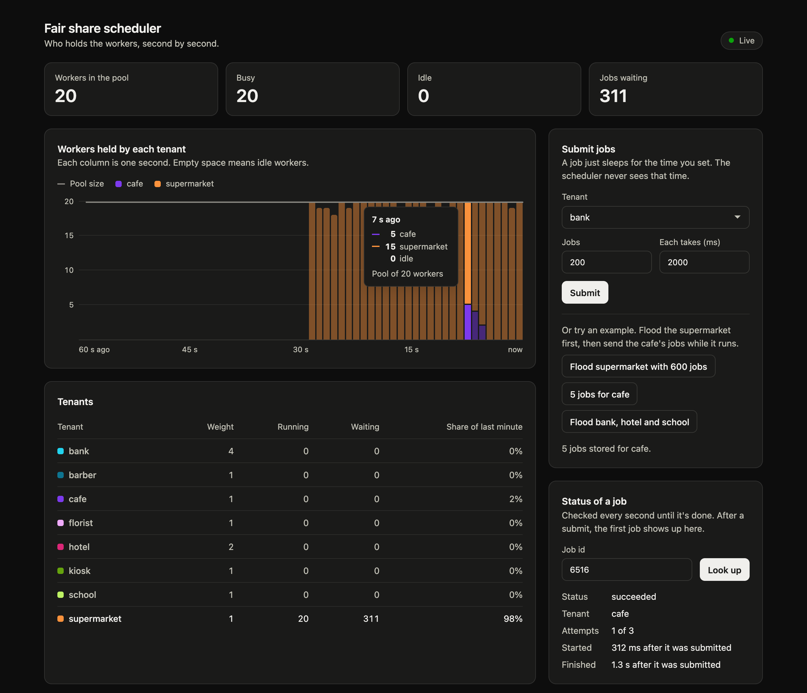

# Fair Share Task Scheduler

Many tenants share one pool of workers. While several tenants have jobs waiting, each gets worker time in proportion to its weight, so one tenant can queue 100,000 jobs without making the others wait.

TypeScript on Node 24, with Postgres as the only storage and the queue. The scheduling logic is in [`src/fairshare.ts`](src/fairshare.ts). The design, guarantees and limits are in [docs/design.md](docs/design.md), with two diagrams in [docs/architecture.md](docs/architecture.md). [docs/spec.md](docs/spec.md) lists each requirement and the test that checks it.

## Run it

```bash
docker compose up --build
```

This starts Postgres, the API on port 8080, the scheduler, 4 worker processes of 5 slots each (a pool of 20), and a live page on port 8090. Tenants and weights come from `tenants.json`.

```bash
curl -s -X POST localhost:8080/jobs -H 'content-type: application/json' \
  -d '{"tenant_id": "cafe", "payload": {"sleep_ms": 200}}'
# {"id":"1","status":"pending"}

curl -s localhost:8080/jobs/1
# {"id":"1","tenant_id":"cafe","status":"succeeded","attempts":1, ...}
```

A job sleeps for `sleep_ms`. `fail_attempts: N` makes its first N attempts fail. The scheduler never reads the payload.

## Watch it live

Open <http://localhost:8090>, press "Flood supermarket with 600 jobs", then "5 jobs for cafe" while it runs.



The page is an extra, not asked for by the brief. It is another client of the same API and reads `GET /pool` once a second. Code in [`web/`](web), React and Vite.

## Tests

```bash
docker compose run --rm test       # scheduler: 63 tests
docker compose run --rm web-test   # page: 72 tests
```

They cover the fair share logic, a simulated pool, the API, and crash tests with real processes: a worker killed mid job, a worker stopped, Postgres down or frozen.

## Load test

```bash
docker compose run --rm loadtest   # about 2 minutes, empties the job table
```

Full output in [`results/`](results). From a run on a laptop, pool of 20:

`supermarket` has 99,004 jobs waiting when four small tenants submit 5 to 10 jobs each. Every small job started within 542 ms. One shared queue would have made them wait about 23 minutes.

```
 tenant  jobs  wait p50  wait p95  wait max
 barber     8    273 ms    361 ms    363 ms
   cafe     5    336 ms    358 ms    358 ms
florist    10    422 ms    515 ms    542 ms
  kiosk     7    152 ms    378 ms    387 ms
```

Three tenants with weights 1, 2 and 4 and very different job lengths, measured over 60 seconds:

```
tenant  weight  jobs done  share  target
school       1       1580  14.3%   14.3%
 hotel       2        654  28.6%   28.6%
  bank       4        318  57.1%   57.1%
```

## See a crash recovery

```bash
for i in $(seq 40); do
  curl -s -o /dev/null -X POST localhost:8080/jobs -H 'content-type: application/json' \
    -d '{"tenant_id": "supermarket", "payload": {"sleep_ms": 20000}}'
done
docker kill $(docker compose ps -q worker | head -1)
```

About 10 seconds later (the lease) the dead worker's 5 jobs run again on the other workers, with `attempts = 2`. All 40 end as `succeeded`.

Settings such as the lease, retries and pool size are environment variables, listed in [`src/config.ts`](src/config.ts).
