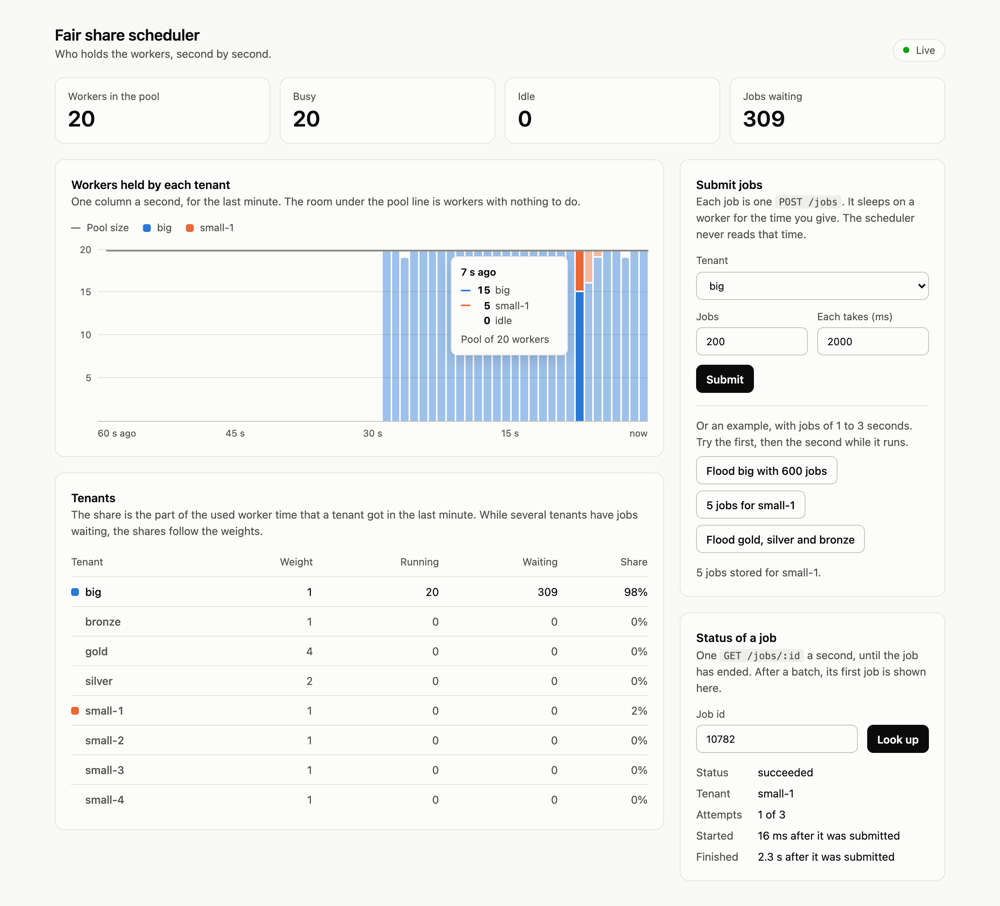

# Fair Share Task Scheduler

A job scheduler for a platform with many tenants. All tenants share one pool of workers. Each tenant with work waiting gets a share of worker time in proportion to its weight, so one tenant can queue 100,000 jobs without making the others wait.

TypeScript on Node 24, and Postgres as the only storage and as the queue. The scheduling logic is written by hand in [`src/fairshare.ts`](src/fairshare.ts).

The design, the guarantees and the limits are in [DESIGN.md](DESIGN.md).

## Run it

```bash
docker compose up --build
```

| Service      | What it does                                                            |
| ------------ | ----------------------------------------------------------------------- |
| `db`         | Postgres 17                                                             |
| `migrate`    | creates the tables, seeds the tenants from `tenants.json`, then exits   |
| `api`        | HTTP API on port 8080                                                   |
| `scheduler`  | decides which tenant runs next                                          |
| `worker` x 4 | four separate processes, 5 jobs at once each: a pool of 20              |
| `web`        | a live page on port 8090. An extra, see [Watch it live](#watch-it-live) |

Submit a job, then read its status:

```bash
curl -s -X POST localhost:8080/jobs -H 'content-type: application/json' \
  -d '{"tenant_id": "cafe", "payload": {"sleep_ms": 200}}'
# {"id":"1","status":"pending"}

curl -s localhost:8080/jobs/1
# {"id":"1","tenant_id":"cafe","status":"succeeded","attempts":1,"max_attempts":3,
#  "created_at":"...","started_at":"...","finished_at":"...","run_at":"...","last_error":null}
```

- Tenants and weights come from `tenants.json`: `supermarket`, the one that floods the queue, and four small tenants: `cafe`, `kiosk`, `barber` and `florist`. All five have weight 1. Then `school` (weight 1), `hotel` (2) and `bank` (4), to show the weights.
- The worker simulates work from the payload: `sleep_ms` is how long the job takes, `fail_attempts` makes it fail on its first N attempts. The scheduler never reads the payload.
- More workers: `docker compose up -d --scale worker=8`. The scheduler sees the new pool size by itself.
- After a code change: `docker compose up -d --build`.

## Watch it live

Open <http://localhost:8090>.



The brief does not ask for a front end. This page is an extra, and one more client of the same API: it reads `GET /pool` once a second, and its form sends one `POST /jobs` for each job.

- **The chart** draws one column a second, for the last minute: the workers each tenant holds, under the line of the pool size. Point at a column, or use the arrow keys, to read the numbers of that second.
- **The table** has the numbers of this moment, and the share of the used worker time that each tenant got in the last minute.
- **Submit jobs** and **Status of a job** do what the two `curl` calls above do.

The examples under the form tell the story in three presses:

1. **Flood supermarket with 600 jobs.** It is alone, so it takes all 20 workers.
2. **5 jobs for cafe**, while they run. The 5 jobs start as soon as workers of `supermarket` free up, at most one job length later, and no job of `supermarket` is stopped for them. Then `supermarket` gets the pool back.
3. **Flood bank, hotel and school**, when `supermarket` is done. The Share column settles close to 57%, 29% and 14%: the weights 4, 2 and 1.

The page is a package of its own in [`web/`](web): React, TypeScript and Vite, served by nginx in Docker. It polls instead of holding a connection open, so the API stays stateless. To work on it while the stack runs: `cd web && npm install && npm run dev`.

## How it works

```
client -- POST /jobs --> API -- insert as "pending" ---+
                                                       v
scheduler -- "pending" to "ready", by fair share --> Postgres   (the jobs table is the queue)
                                                       ^
workers -- claim "ready", run, save the result --------+
```

1. The **API** stores the job as `pending`.
2. Every 20 ms the **scheduler** runs one short transaction:
   - it takes back the jobs whose worker went silent,
   - it counts the slots of the workers that are alive,
   - it loads one row per tenant: weight, worker time used, running and waiting jobs,
   - it gives each free slot to the tenant with waiting jobs that has used the least worker time for its weight,
   - it marks that tenant's oldest waiting job `ready`.
3. A **worker** claims `ready` jobs with `FOR UPDATE SKIP LOCKED`, runs them, and extends their lease with a heartbeat every 2 seconds.
4. When a job ends, one SQL statement saves the result and adds the time it used to the tenant's usage.

Job states:

| State       | Meaning                                                                         |
| ----------- | ------------------------------------------------------------------------------- |
| `pending`   | waiting for the scheduler                                                       |
| `ready`     | picked by the scheduler, waiting for a worker (the API reports it as `pending`) |
| `running`   | a worker holds it under a lease                                                 |
| `succeeded` | done                                                                            |
| `failed`    | the attempt threw an error, a retry starts after 2 s, then 4 s                  |
| `dead`      | failed or crashed 3 times, kept with its last error                             |

Where things are:

| File                  | Role                                                                             |
| --------------------- | -------------------------------------------------------------------------------- |
| `src/fairshare.ts`    | the scheduling decision: a pure function, no database. Start here.               |
| `src/scheduler.ts`    | the loop around it: reads Postgres, applies the decision, recovers crashed jobs  |
| `src/worker.ts`       | claim, run, heartbeat, report                                                    |
| `src/api.ts`          | `POST /jobs` and `GET /jobs/:id`, and `GET /pool` for the live page              |
| `db/schema.sql`       | three tables: `tenants`, `jobs`, `workers`                                       |
| `scripts/loadtest.ts` | the load test                                                                    |
| `test/`               | unit tests, a simulation of the pool, API and crash tests with real processes    |
| `web/`                | the live page: `src/api.ts` is its client of the API, `src/history.ts` its rules |

## Tests

```bash
docker compose run --rm test       # the scheduler: 62 tests
docker compose run --rm web-test   # the live page: 72 tests
```

The tests of the scheduler:

- `api.test.ts`: the real API process on a real Postgres. Submit and read back, unknown tenant, unknown job, and a request that can never work gets 400, not the 503 that asks for a retry. `GET /pool` counts the pool the way the scheduler does. When Postgres stops answering, the API says 503 instead of leaving the client waiting.
- `fairshare.test.ts`: the "pick the next tenant" logic. Weights, the cap, the idle rule, a tenant alone.
- `simulation.test.ts`: the same function driving a simulated pool. A flood, weights 1, 2, 4, 5 minute jobs, 60 tenants.
- `recovery.test.ts`: a real scheduler and real workers on a real Postgres. A worker is killed with SIGKILL in the middle of a job and the job is retried. A worker that is stopped hands its job back: no attempt is used, and the tenant is still charged for the worker time. Postgres is cut off from a worker for 6 seconds and the finished job is not run again. A result that arrives after the lease was lost is refused. A result that Postgres refuses is given up, not offered for ever. A job that fails once succeeds on the retry. A job that always fails is `dead` after 3 attempts. A scheduler that freezes in the middle of a pass loses its lock, and the next pass works. Postgres stops answering for a second, and scheduler and worker carry on afterwards. Postgres is away for longer than the lease, and the scheduler does not take the job of a live worker back.
- `db.test.ts`: a connection that Postgres closes between two statements does not stop the process, every connection carries the time limits, and an error tells whether Postgres was away or refused the statement.
- `worker.test.ts`, `scheduler.test.ts` and `config.test.ts`: the retry backoff, a check that the scheduling code never mentions the payload, the wait before leases are judged after an outage, and a setting that is not a whole number stops the process at start.

The tests of the page run without a browser and without the API (jsdom, and a stand-in for `fetch`): the client of the API, the history of the pool, the polling, the chart with pointer, touch and keyboard, the two forms, and the page as a whole.

Without Docker: `npm install && npm test`, with Node 24 or newer. The database tests use the Postgres of `docker compose up -d db` on port 54329, and are skipped when it is not reachable. For the page: `cd web && npm install && npm test`.

## Load test

```bash
docker compose run --rm loadtest           # both scenarios, about 2 minutes
docker compose run --rm loadtest flood     # only the first
docker compose run --rm loadtest weights   # only the second
```

The script submits jobs through the HTTP API and measures from the job timestamps in Postgres. It prints a report and writes it to `results/` as text and CSV. **It empties the job table before and after.**

It measures the services that are running. After a code change, rebuild them first: `docker compose up -d --build`.

The numbers below come from a real run on a laptop (Docker VM with 6 CPUs, pool of 20 worker slots). The files of that run are in [`results/`](results).

### Scenario 1: one tenant floods

`supermarket` submits 100,000 jobs of 50 to 500 ms through the API (12,885 jobs per second). Then four small tenants submit 5, 7, 8 and 10 jobs. At that moment 99,280 jobs of `supermarket` are still waiting.

```
 tenant  jobs  wait p50  wait p95  wait max  all jobs done after
-------  ----  --------  --------  --------  -------------------
   cafe     5    191 ms    265 ms    273 ms               587 ms
  kiosk     7    207 ms    361 ms    425 ms               701 ms
 barber     8    282 ms    316 ms    316 ms               623 ms
florist    10    370 ms    467 ms    467 ms               727 ms
```

Every job of a small tenant started within 467 ms. In one first in, first out queue they would have waited about 23 minutes.

The wait is not 0 because there is no preemption: when the small tenants arrive every worker is busy with a job of `supermarket`, and they wait for those jobs to finish.

Who held the workers, per 5 second bucket (time 0 is when the small tenants submit):

```
time  supermarket  cafe  kiosk  barber  florist                          pool of 20 workers
----  -----------  ----  -----  ------  -------  ------------------------------------------
-10s         18.4   0.0    0.0     0.0      0.0  |#####################################...|
 -5s         18.3   0.0    0.0     0.0      0.0  |#####################################...|
 +0s         16.8   0.3    0.4     0.3      0.4  |##################################kb....|
 +5s         18.3   0.0    0.0     0.0      0.0  |#####################################...|
+10s         18.3   0.0    0.0     0.0      0.0  |#####################################...|
(average workers held per tenant. # = supermarket, c = cafe, k = kiosk, b = barber, f = florist, . = idle)
```

The same, zoomed in on the arrival (250 ms buckets):

```
  time  supermarket  cafe  kiosk  barber  florist                          pool of 20 workers
------  -----------  ----  -----  ------  -------  ------------------------------------------
-0.50s         19.0   0.0    0.0     0.0      0.0  |######################################..|
-0.25s         17.6   0.0    0.0     0.0      0.0  |###################################.....|
+0.00s         11.8   1.4    1.6     1.9      2.1  |########################cckkkkbbbffff...|
+0.25s          3.4   3.7    4.3     3.8      3.0  |#######ccccccckkkkkkkkkbbbbbbbffffff....|
+0.50s         11.6   0.7    1.3     1.0      3.2  |#######################cckkbbfffffff....|
+0.75s         18.1   0.0    0.0     0.0      0.0  |####################################....|
+1.00s         18.3   0.0    0.0     0.0      0.0  |#####################################...|
+1.25s         18.2   0.0    0.0     0.0      0.0  |####################################....|
+1.50s         18.2   0.0    0.0     0.0      0.0  |####################################....|
+1.75s         17.9   0.0    0.0     0.0      0.0  |####################################....|
+2.00s         18.3   0.0    0.0     0.0      0.0  |#####################################...|
+2.25s         18.4   0.0    0.0     0.0      0.0  |#####################################...|
(average workers held per tenant. # = supermarket, c = cafe, k = kiosk, b = barber, f = florist, . = idle)
```

What it shows:

- While it is alone, every worker goes to `supermarket`.
- When the others arrive, `supermarket` falls from 18 workers to about its fair share (4 of 20, there are 5 tenants) within 250 ms, and no job is stopped for it.
- When the small tenants are done, `supermarket` gets the whole pool back.

About 1.7 of the 20 workers show as idle (the dots). Each job start waits for the next scheduler pass and the next worker poll, 20 ms each, and these jobs are short. [DESIGN.md](DESIGN.md) section 4 says how to remove that.

### Scenario 2: weights 1, 2 and 4

`school`, `hotel` and `bank` each keep a deep backlog for 60 seconds. Their jobs have very different lengths on purpose: 50 to 150 ms, 200 to 800 ms, and 1 to 3 s.

```
tenant  weight  jobs done  worker seconds  share  target
------  ------  ---------  --------------  -----  ------
school       1       1601           161.4  14.3%   14.3%
 hotel       2        637           323.1  28.5%   28.6%
  bank       4        326           647.9  57.2%   57.1%
```

Worker time follows the weights to within 0.1 point, although `school` ran about 5 times more jobs than `bank`. The split holds in every 5 second bucket:

```
time  school  hotel  bank                          pool of 20 workers
----  ------  -----  ----  ------------------------------------------
 +0s     2.7    5.4  10.7  |11111222222222224444444444444444444444..|
 +5s     2.6    5.3  10.9  |11111222222222224444444444444444444444..|
+10s     2.7    5.4  10.8  |11111222222222224444444444444444444444..|
+15s     2.7    5.4  10.7  |11111222222222224444444444444444444444..|
+20s     2.6    5.4  10.9  |11111222222222224444444444444444444444..|
+25s     2.7    5.4  10.7  |11111222222222224444444444444444444444..|
+30s     2.7    5.3  10.9  |11111222222222224444444444444444444444..|
+35s     2.7    5.5  10.6  |11111222222222224444444444444444444444..|
+40s     2.7    5.4  10.8  |11111222222222224444444444444444444444..|
+45s     2.7    5.4  10.8  |11111222222222224444444444444444444444..|
+50s     2.7    5.2  11.0  |11111222222222224444444444444444444444..|
+55s     2.7    5.5  10.7  |11111222222222224444444444444444444444..|
(average workers held per tenant. 1 = school, 2 = hotel, 4 = bank, . = idle)
```

### The scheduler keeps up

With 100,000 jobs queued a scheduler pass takes 2 to 3 ms, the same as with an empty queue. The scheduler prints it: `docker compose logs scheduler`.

## See a crash recovery

```bash
# 40 jobs of 20 seconds: each of the 4 workers takes 5
for i in $(seq 40); do
  curl -s -o /dev/null -X POST localhost:8080/jobs -H 'content-type: application/json' \
    -d '{"tenant_id": "supermarket", "payload": {"sleep_ms": 20000}}'
done

# kill one worker without warning
docker kill $(docker compose ps -q worker | head -1)

# run this a few times
docker compose exec db psql -U postgres -d scheduler \
  -c "SELECT status, attempts, count(*) FROM jobs GROUP BY 1, 2 ORDER BY 1, 2"

# bring the worker back
docker compose up -d
```

About 10 seconds after the kill (the lease time) the 5 jobs of the dead worker are `pending` again. They are first in line, they start again with `attempts = 2`, and all 40 jobs end as `succeeded`.

A worker that is stopped instead of killed (a deploy, or `docker compose up -d --scale worker=3`) gets 8 seconds to finish its jobs. The ones still running go back to the queue at once, and that does not count as an attempt.

## See a database outage

```bash
# 150 jobs of 400 ms
for i in $(seq 150); do
  curl -s -o /dev/null -X POST localhost:8080/jobs -H 'content-type: application/json' \
    -d '{"tenant_id": "supermarket", "payload": {"sleep_ms": 400}}'
done

# Postgres is gone for 15 seconds, longer than the lease
docker compose stop db && sleep 15 && docker compose start db

# a few seconds later
docker compose exec db psql -U postgres -d scheduler \
  -c "SELECT status, attempts, count(*) FROM jobs GROUP BY 1, 2 ORDER BY 1, 2"
```

All 150 jobs end as `succeeded` with `attempts = 1`: none is lost and none runs twice.

- While Postgres is away, no call waits longer than 5 seconds (`DB_TIMEOUT_MS`). The API answers 503, the scheduler and the workers retry every second.
- A worker keeps the result of a job it finished until Postgres takes it.
- When Postgres is back, every lease has run out, but no worker died. The scheduler waits one lease before it takes any job back, so the workers that are alive keep theirs.

`docker compose pause db` and `unpause db` show a Postgres that stops answering instead of being down. There a job can end with `attempts = 2`: a worker took it, the answer never arrived, and the job waited for its lease to run out before it ran.

## Settings

Environment variables and their defaults. In Docker, set them under `x-app` in `docker-compose.yml`.

| Variable            | Default | Meaning                                                                                       |
| ------------------- | ------- | --------------------------------------------------------------------------------------------- |
| `WORKER_SLOTS`      | 5       | jobs one worker process runs at once                                                          |
| `TICK_MS`           | 20      | pause between two scheduler passes                                                            |
| `POLL_MS`           | 20      | how often a free worker looks for a job                                                       |
| `HEARTBEAT_MS`      | 2000    | how often a worker extends its leases                                                         |
| `LEASE_MS`          | 10000   | a job goes back to the queue when its worker is silent this long                              |
| `SHUTDOWN_GRACE_MS` | 8000    | how long a stopped worker lets its jobs finish before it hands them back                      |
| `MAX_ATTEMPTS`      | 3       | attempts before a job is `dead`                                                               |
| `BACKOFF_MS`        | 2000    | wait before the first retry, doubled for the next one                                         |
| `DB_TIMEOUT_MS`     | 5000    | a call to Postgres fails when it gets no answer for this long (the migration gets 10 minutes) |
| `API_PORT`          | 8080    | port of the API on the host                                                                   |
| `DB_PORT`           | 54329   | port of Postgres on the host                                                                  |
| `WEB_PORT`          | 8090    | port of the live page on the host                                                             |
