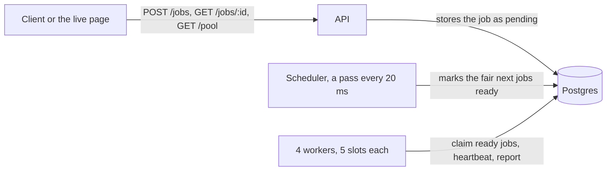
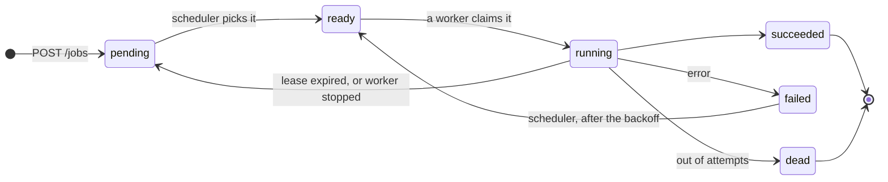

# Architecture

## The parts

The parts never call each other. They only read and write Postgres, which is the storage and the queue. Only the scheduler decides which tenant gets a free slot. A worker runs whatever is marked ready, oldest first.

## The life of a job

A job gets 3 attempts, with a backoff of 2 s, then 4 s. A worker keeps a job only while its heartbeats renew the 10 s lease. If they stop, the scheduler puts the job back, so a job can run twice but is never lost. A result from a worker that lost its lease is ignored.

Why it works this way, and what it costs, is in [design.md](design.md).
